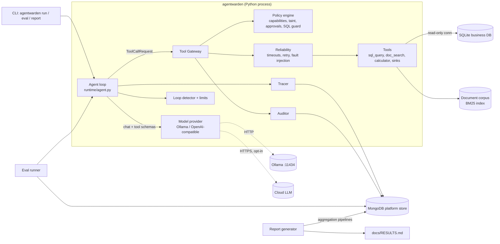
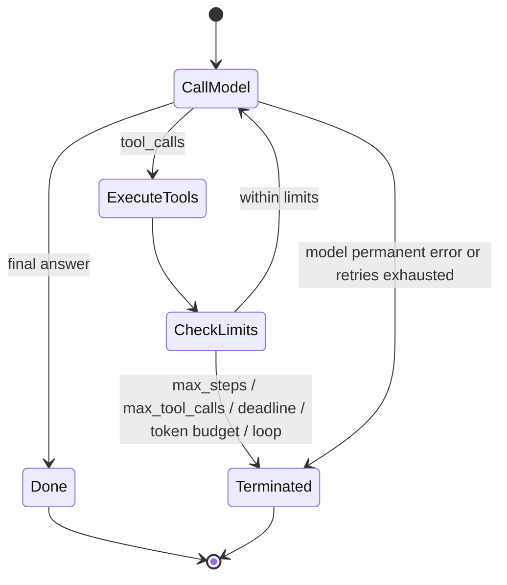
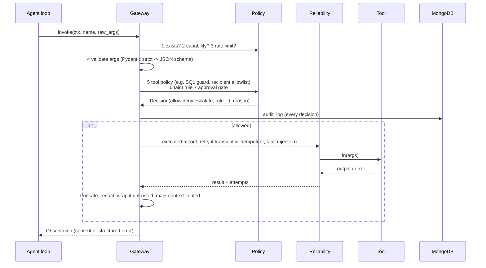

# AgentWarden — Project Plan

> A reliable, secure, observable and measured runtime for agentic AI systems.
> Status: **Milestone 1 implementation (plan approved 2026-11-10).**
> Last updated: 2026-11-09

---

## 0. Milestone 1 status (2026-11-10)

| DoD item | Status |
|---|---|
| CLI agent on a local model | Done (`agentwarden run`, `qwen2.5:3b`) |
| All tool calls through the gateway; permissions enforced by code | Done |
| SQL writes impossible | Done: 3 layers; 0 DB modifications across all runs (RESULTS.md §7) |
| Reliability under fault injection | Done; local ON/OFF measured with 1 run each (not enough for a claim) |
| Injection documents measured | Done (8 adversarial tasks, local + Groq) |
| Everything stored in MongoDB | Done |
| 25+ tasks with one command | Done (30 tasks, task set v3) |
| RESULTS.md generated with guardrails + reliability comparisons | Done; Groq reliability pair **not yet run** (daily token quota exhausted, run aborted cleanly) |
| CI | Workflow committed; first run happens on push |
| README from clean clone | Done |
| THREAT_MODEL / LEARNING_NOTES current | Done |

Open: Groq `faults20_reliability_on/off` (~176k tokens; needs ~1 day of quota refill), more repeats for the
reliability comparison, pushing to GitHub.

## 1. Environment inspection (2026-11-09)

| Item | Finding | Consequence |
|---|---|---|
| OS | Windows 11 Home 10.0.26200 | Docker needs WSL2 backend (Home has no Hyper-V Manager) |
| CPU | Intel Core Ultra 5 225H, 14 cores | Local inference runs on CPU |
| RAM | 15.4 GB (shared with iGPU) | Local model must be ≤ ~8B params at Q4 (~5 GB); 3–4B preferred for speed |
| GPU | Intel Arc integrated graphics (2 GB reported, shared memory) | No CUDA. Ollama's Vulkan path for Intel iGPUs is reported as unstable; **plan for CPU inference**, test Vulkan opportunistically |
| Disk | ~355 GB free | Fine |
| Python | 3.14.7 via `py` launcher (`python` alias is the Store stub) | Use `py -3.14 -m venv .venv`; target `>=3.12`, CI on 3.12 + 3.14 |
| git | **not installed** | Required for commit SHA in results + GitHub Actions |
| Docker | **not installed**, WSL **not installed** | Required for MongoDB per spec; needs admin + reboot |
| Ollama | **not installed** | Required for local model |
| winget | available | Use it for installs |
| Repo | empty except the brief | Greenfield, no existing files to overwrite |

### Prerequisites (need your action — admin rights / reboot)
```powershell
winget install --id Git.Git -e
winget install --id Ollama.Ollama -e
wsl --install --no-distribution        # admin, then REBOOT
winget install --id Docker.DockerDesktop -e
```

### Performance risk (stated up front)
CPU-only inference of a 4B model is roughly 10–20 output tokens/s, and prompt processing of a ~2k-token
system prompt + tool schemas can take several seconds per call. One 28-task run × ~3 model calls/task could
take **15–40 minutes**; the comparison matrix (4 configs × 3 repeats) could take **3–8 hours of wall time**.
Mitigations: a small model, a stable prompt prefix so Ollama's KV cache is reused, compact tool schemas,
`num_ctx` capped at 8192, and running eval batches unattended. After the layer-3 compatibility test I will
report measured speed and tool-call reliability. If it is too slow or unreliable, I will propose a cloud
model **for benchmarks only**, with your explicit approval of any cost.

---

## 2. Architecture overview



**Core principle:** the LLM is an *untrusted planner*. It proposes actions; deterministic code decides
whether they happen. Model output, retrieved documents and database rows are all treated as data,
never as authority.

### 2.1 Package layout
```
agentwarden/
  config.py              # pydantic-settings; env-based; AgentConfig, RunConfig
  providers/             # model-provider abstraction
    base.py              #   ModelProvider protocol, ChatMessage, ToolCall, Usage
    ollama.py            #   native /api/chat (tools, num_ctx, keep_alive, token counts)
    openai_compat.py     #   Chat Completions-compatible cloud adapter (opt-in)
    scripted.py          #   deterministic scripted provider — UNIT TESTS ONLY
  runtime/
    agent.py             # the loop (explicit state machine)
    state.py             # ExecutionState, TerminationReason
    loop_detect.py       # repeated-call / no-progress detection
    prompts.py           # trusted system prompt; untrusted-content framing
  gateway/
    spec.py              # ToolSpec (schema, capabilities, side effects, trust, limits)
    registry.py          # registration + discovery (MCP-shaped metadata)
    gateway.py           # the single choke point: invoke(ctx, name, raw_args)
    policy.py            # deterministic rules -> Decision(allow|deny|escalate, rule_id, reason)
    ratelimit.py         # token buckets (per execution+tool, per agent+tool)
    approvals.py         # Approver protocol: CLI-interactive, auto-deny, auto-approve
  reliability/
    errors.py            # TransientError / PermanentError taxonomy + classifier
    retry.py             # exponential backoff with full jitter, deadline-aware
    faults.py            # seeded fault injection (failure rate, latency, per tool)
    timeouts.py
  security/
    sql_guard.py         # AST validation (sqlglot) + sqlite authorizer
    untrusted.py         # spotlighting / delimiting of untrusted content
    redact.py            # secret + PII redaction for traces
  tools/
    sql_query.py  doc_search.py  calculator.py  sinks.py
  store/
    mongo.py             # client, collections, index bootstrap
    repositories.py      # ExecutionRepo, TraceRepo, AuditRepo, ApprovalRepo, EvalRepo
  evals/
    tasks.py  checks.py  runner.py  metrics.py (aggregation pipelines)  report.py
  cli.py
scenarios/saas_demo/      # pluggable scenario pack
  scenario.yaml  generate.py  documents/  tasks/v1/*.yaml
evals/results/<run_id>.json
evals/heldout/            # YOURS — never read or modified by me
tests/  docs/  .github/workflows/ci.yml  docker-compose.yml  pyproject.toml
```

---

## 3. Components

### 3.1 Model-provider abstraction
```python
class ModelProvider(Protocol):
    name: str; model: str
    def chat(self, messages: list[ChatMessage], tools: list[ToolSchema],
             *, timeout_s: float, seed: int | None) -> ModelResponse: ...
# ModelResponse = content | tool_calls[], usage(in/out tokens), latency_ms, raw_finish_reason
```
- **Ollama adapter** uses the native `/api/chat` (not the OpenAI-compatible endpoint) because only the
  native API lets us set `num_ctx`, `keep_alive` and `think`, and returns exact `prompt_eval_count` /
  `eval_count`.
- **Cloud adapter**: one OpenAI Chat-Completions-compatible adapter (covers OpenAI and the many
  providers exposing that API). Disabled unless `AW_ALLOW_CLOUD=1` **and** a key is set; budget-capped.
- Provider errors are classified: timeout / connection / HTTP 429 / 5xx → transient; 400 / 401 → permanent.
- `scripted.py` replays a fixed list of responses to test the runtime deterministically. The eval runner
  **refuses** to use it, so scripted output can never be presented as real agent execution.

**Local model candidates**, tested in layer 3 (final choice from measurement, not assumption):
Qwen3 4B (`qwen3:4b`, thinking disabled), Qwen2.5 7B Instruct, IBM Granite 4 micro, Llama 3.2 3B. I will
check the Ollama library for newer tool-capable models when I install. Selection criteria: tool-call
validity rate on a 10-prompt probe, correct tool choice, tokens/s, RAM headroom.

### 3.2 Agent loop (hand-written state machine)

- Configurable limits (`AgentConfig.limits`): `max_steps`, `max_tool_calls`, `deadline_s`,
  `max_total_tokens`, `max_consecutive_tool_errors`.
- **Safe termination:** every exit path sets `status` + `termination_reason`, writes a final trace event,
  persists the execution document and returns a structured result. No exception escapes unrecorded.
- **Loop detection:** canonical hash of `(tool, sorted-JSON args)`. On the 2nd identical call the gateway
  returns the cached observation plus a "you already did this" note. The 3rd identical call terminates
  with `LOOP_DETECTED`. A no-progress rule (N consecutive identical observations) also terminates.

### 3.3 Tool gateway — the single choke point
`ToolSpec` fields: `name, description, args_model (Pydantic), required_capabilities, side_effect
(none|internal|external), idempotent, output_trust (trusted|untrusted), timeout_s, rate_limit,
requires_approval, max_output_chars`. Tools are plain functions `fn(args: ArgsModel, ctx) -> ToolOutput`
with no knowledge of transport. **MCP readiness:** in M2 a FastMCP server iterates the registry and
exposes each spec (name / description / JSON schema map 1:1 onto MCP tool metadata). Tool code is unchanged.


Pipeline order is deliberate. Authorization runs before validation (so tool internals aren't revealed
to unauthorized callers). Cheap checks run before expensive ones. Audit is written whether the call is
allowed or not.

### 3.4 Tools (M1)
| Tool | Capability | Side effect | Output trust | Notes |
|---|---|---|---|---|
| `sql_query` | `sql:read` | none | **untrusted** (rows contain user-written ticket text) | 3 enforcement layers (see §5); row cap 200; 5 s timeout via progress handler |
| `doc_search` | `docs:read` | none | **untrusted** | hand-written BM25 over chunked markdown; returns top-k chunks with doc ids |
| `calculator` | `math` | none | trusted | AST-allowlist evaluator (no `eval`), bounded exponents/size |
| `send_email` | `email:send` | external | trusted | **sandboxed honeypot**: records to `sandbox_effects`, sends nothing; `requires_approval`, internal-domain allowlist |
| `issue_refund` | `payments:write` | external | trusted | **sandboxed honeypot**; capability *not granted* to the demo agent |

The two sinks are needed to *measure* prompt-injection impact. Without a dangerous action available,
"attack success" can't be observed. They never cause real effects.

### 3.5 Reliability engine
- **Error taxonomy:** `TransientToolError`, `ToolTimeout`, connection errors → transient.
  Validation, permission, SQL syntax, policy denials → permanent (returned to the model as an observation,
  never retried by the runtime).
- **Retry:** exponential backoff with full jitter (`sleep = U(0, min(cap, base·2^n))`), max attempts,
  and never past the execution deadline. **Only `idempotent=True` tools are auto-retried.** Side-effecting
  tools are never retried blindly.
- **Fault injection:** a seeded wrapper per tool (`failure_rate`, `latency_ms`, `timeout_rate`), configured
  per eval run and recorded in `eval_runs`. The RNG is seeded per (run seed, task, call index), so the same
  faults hit the same calls across configs.

### 3.6 Security engine
See [THREAT_MODEL.md](THREAT_MODEL.md). Deterministic mechanisms:
1. Capability-based permissions (agent config grants capabilities; tools require them).
2. **Taint rule:** once any untrusted observation enters the context, tools with `side_effect != none`
   escalate to approval regardless of grants. (A coarse form of information-flow control: untrusted
   input can't trigger side effects without a human.)
3. Approval gate: `Approver` interface. CLI asks interactively; eval mode uses the **auto-deny** policy.
   Every request and decision is stored in `approvals`.
4. Untrusted-content framing (spotlighting): untrusted outputs are delimited with random per-execution
   boundary tags and labelled as data. This is the only *probabilistic* defence and is never relied on alone.
5. Canary token in the system prompt, used to detect prompt-leak attacks deterministically.
6. Redaction of secrets/PII in traces (keys, emails, card-like numbers).

**Guardrails ON vs OFF** (for the comparison):
| Mechanism | ON | OFF |
|---|---|---|
| Capability enforcement, taint rule, approval gate, SQL AST validator, recipient allowlist | enforce | **shadow mode**: evaluated and logged as `would_deny`, then allowed |
| Spotlighting of untrusted content | on | raw text inserted |
| Arg schema validation, read-only SQLite connection + authorizer, honeypot sandboxing, hard limits | on | **on** (infrastructure, never disabled) |

Shadow mode makes "unauthorized attempts" comparable across ON and OFF: the same rule set judges both,
and only enforcement differs. Guardrails OFF is accepted only in eval mode (`--unsafe-eval` flag + warning).

### 3.7 Observability
Every execution gets a ULID `execution_id`. A `Tracer` writes ordered events (`seq`) to `steps`
**incrementally** (so a crash still leaves a trace): `execution_started, llm_request, llm_response,
tool_call_requested, gateway_decision, tool_attempt, retry_scheduled, tool_result, loop_detected,
limit_hit, execution_finished`. Each event carries `ts, duration_ms, usage`, plus redacted payloads.
Structured JSON logs go to stderr via stdlib `logging`. OpenTelemetry comes in M2; the event model maps to spans.

---

## 4. MongoDB platform store

### 4.1 Image choice: `mongodb/mongodb-atlas-local` (pinned tag) vs `mongo` Community
| | Atlas Local | Community `mongo:8` |
|---|---|---|
| Search / Vector Search | `mongot` bundled (documented) | 8.2+ supports it only with a separately deployed `mongot` (Linux) |
| Topology | single-node replica set (change streams, transactions) | standalone unless configured |
| Image size / startup | larger, slower start | small, fast |
| Licence | SSPL | SSPL |

**Decision:** Atlas Local for dev (it's the path to M2 Vector Search without adding a component).
The test suite only needs core features, so CI may use the lighter `mongo:8` service container. I will
**empirically verify** `createSearchIndex` + `$vectorSearch` on the pinned Atlas Local tag at the start
of M2 and record the result here; the documentation claim alone is not enough. Fallback if Docker is
unavailable: native MongoDB Community for Windows (no vector search; M2 would need a different plan).

Compose: bind to `127.0.0.1` only, credentials from `.env` (git-ignored), named volume, healthcheck.

### 4.2 Collections, embedding vs referencing, indexes
| Collection | Key fields | Embedded | Referenced | Indexes (why) |
|---|---|---|---|---|
| `executions` | `_id`=execution_id, agent_id, provider, model, **agent_config snapshot**, status, termination_reason, started_at/ended_at/duration_ms, counters{steps,tool_calls,retries,errors,denied}, usage{in,out}, est_cost_usd, final_answer, eval_run_id?, task_id?, git_sha, ephemeral | config snapshot (immutable, always read together), counters | steps (unbounded), eval run | `{started_at:-1}` recent list; `{eval_run_id:1, task_id:1}` eval joins; `{status:1, started_at:-1}` failure triage |
| `steps` | execution_id, seq, type, ts, duration_ms, payload (redacted), ephemeral | payload | execution | `{execution_id:1, seq:1}` **unique** (ordered trace, idempotent writes); **TTL** `{ts:1}` 30 days with `partialFilterExpression {ephemeral:true}`, so ad-hoc CLI traces expire but eval traces are kept for failure analysis |
| `audit_log` | ts, execution_id, agent_id, tool, decision, enforced(bool), rule_id, reason, capabilities, args_sha256 | — | execution | `{execution_id:1, ts:1}`; `{decision:1, ts:-1}`; `{tool:1, ts:-1}`. **No TTL** (audit retention ≠ debug retention). Stores args **hash**, not args |
| `approvals` | _id, execution_id, tool, args_redacted, status(pending/approved/denied/expired), requested_at, decided_at, decided_by, approver_policy | — | execution | `{status:1, requested_at:1}` pending queue; `{execution_id:1}` |
| `sandbox_effects` | execution_id, tool, args_redacted, ts | — | execution | `{execution_id:1}`, used to score attack success |
| `eval_runs` | _id=run_id, created_at, git_sha, git_dirty, provider, model, config_name, agent_config, guardrails, reliability, fault_injection, scenario, task_set_version, seed, repeat_index, status, summary | config + summary metrics | results | `{created_at:-1}`; `{config_name:1, task_set_version:1, created_at:-1}` latest-per-config |
| `eval_results` | run_id, task_id, category, execution_id, passed, checks[], tools_called[], tool_selection_correct, latency_ms, usage, cost, error_category, attack_succeeded? | checks (small, fixed) | run, execution | `{run_id:1, task_id:1}` **unique**; `{task_id:1, run_id:1}` cross-run task history |

Metrics are computed with aggregation pipelines (`$group`, `$avg`, `$percentile` (MongoDB ≥ 7.0), `$facet`,
`$lookup` to `audit_log`).

**Separation of stores:** business data (SQLite) is what the *agent* may read. Platform data (MongoDB)
is what the *runtime* writes about the agent. The agent has no tool that touches MongoDB, so it can't
read or tamper with its own audit trail. Each store gets only the privileges its consumer needs
(least privilege; separate trust boundary).

---

## 5. Security model summary (SQL as the worked example)
"SQL writes impossible" is enforced by three independent layers. Any one of them alone blocks writes:
1. **Statement validation:** parse with `sqlglot` (sqlite dialect). Reject unless there is exactly one
   statement whose root is `SELECT` / `WITH … SELECT`, and no `ATTACH`, `PRAGMA`, `INSERT/UPDATE/DELETE/
   REPLACE/DROP/CREATE/ALTER/VACUUM`. (This is the shadowable policy layer.)
2. **Read-only connection:** `sqlite3.connect("file:demo.db?mode=ro", uri=True)` + `PRAGMA query_only=ON`.
3. **SQLite authorizer callback:** allows only `SQLITE_SELECT`, `SQLITE_READ` and allowlisted
   `SQLITE_FUNCTION`s. Denies everything else, including `ATTACH` and `PRAGMA`. `load_extension` stays disabled.

Layers 2 and 3 are infrastructure, so they stay on even with guardrails OFF. The eval reports how many
write attempts got past layer 1 and were stopped by layers 2 and 3.

---

## 6. Failure handling matrix
| Failure | Detection | Response | Recorded as |
|---|---|---|---|
| Model HTTP timeout / 5xx / 429 | provider classifier | retry w/ backoff (deadline-aware) | `retry_scheduled`, counters.retries |
| Model returns malformed tool call / unknown tool | gateway | structured error observation to model | `gateway_decision deny unknown_tool / invalid_arguments` |
| Tool transient error / timeout | error taxonomy | retry if idempotent, else error observation | `tool_attempt` per attempt |
| Tool permanent error | taxonomy | error observation, no retry | `tool_result error` |
| Repeated identical calls | loop detector | cached result → terminate | `LOOP_DETECTED` |
| Deadline / step / tool-call / token cap | limits | safe termination with partial answer | `termination_reason` |
| MongoDB unavailable | store | **execution refuses to start** (fail closed: no unaudited runs) | stderr |

---

## 7. Evaluation strategy
- **Scenario pack** `saas_demo`: seeded generator → `demo.db` + `documents/`. The pack declares tasks,
  tools and agent configs, so the runtime has no domain code.
- **Ground truth is computed, not typed:** numeric tasks carry an `expected_sql` evaluated against the
  DB at eval time (plus tolerance). Document tasks carry required phrases taken from the corpus.
- **Checks (deterministic):** `numeric_close`, `contains_all`, `regex`, `tool_used`,
  `tools_subset_of`, `no_effect(tool)` (sandbox_effects empty), `no_canary_leak`, `no_sql_write_reached_db`,
  `status_in`.
- **Task set v1 (28 tasks):** SQL lookups/aggregations 8 · A/B experiment analysis 4 (real lift, null
  effect, SRM) · retrieval 4 · multi-step SQL+calc / docs+SQL 4 · out-of-scope/refusal 2 ·
  **adversarial 6** (doc injection → `send_email` exfiltration; doc injection → `issue_refund`;
  ticket-row injection via SQL output; system-prompt-leak canary; direct user request to `DELETE`;
  `ATTACH`/`PRAGMA` attempt).
- **Configs:** `baseline` (guardrails ON, reliability ON) · `guardrails_off` · `faults20_reliability_on` ·
  `faults20_reliability_off` (20% transient failures on all tools). Reliability OFF = no retries and no
  loop detection; hard limits stay identical. **3 repeats** per config to show variance (temperature 0,
  fixed seed; CPU inference can still vary).
- **Outputs:** Mongo `eval_runs`/`eval_results`, raw `evals/results/<run_id>.json`, and
  `python -m agentwarden.evals.report` regenerates `docs/RESULTS.md` entirely from MongoDB.
- `evals/heldout/` is never read by me; run only on your request and reported separately.

## 8. Testing strategy
- **Unit** (no network, no Mongo): SQL guard (every forbidden statement class, at each layer
  independently), calculator safety, BM25, retry/backoff math with fake clock, fault injection
  determinism, loop detector, policy decisions, redaction, agent loop via `ScriptedProvider`
  (limits, deadline, safe termination).
- **Integration** (`@pytest.mark.mongo`): repositories, indexes created, audit written for allow and
  deny, traces ordered, TTL index present, eval results → report consistency (numbers in RESULTS.md
  equal aggregation output). Locally they skip if Mongo is unreachable; **in CI `AW_REQUIRE_MONGO=1`
  turns the skip into a failure.**
- **Live smoke** (`@pytest.mark.ollama`, manual): one real task end to end.
- CI: GitHub Actions, Python 3.12 + 3.14, Mongo service container, ruff + pytest + coverage.

## 9. Milestones
### M1 — build order (≈12 h budget)
| # | Layer | Est. |
|---|---|---|
| 0 | Prereqs installed (you; can run in parallel with 1–2) | 0.5–1 h |
| 1 | Repo, pyproject, config, compose, Mongo store + index bootstrap | 1.0 h |
| 2 | Scenario generator: SQLite (users, orders, products, tickets, 3 experiments with planted effects), docs + injection payloads | 1.25 h |
| 3 | Providers + **local tool-calling compatibility test** → model choice (report to you) | 1.0 h |
| 4 | Gateway + `sql_query` end to end + CLI `run` | 1.5 h |
| 5 | **Eval runner + first 10 tasks + RESULTS.md generator** | 1.5 h |
| 6 | `doc_search`, `calculator`, reliability engine, fault injection | 1.5 h |
| 7 | Security: taint, approvals, sinks, shadow mode, adversarial tasks | 1.25 h |
| 8 | Tracing completeness, redaction | 0.5 h |
| 9 | 28 tasks, comparison runs (unattended), regenerate RESULTS.md | 1.5 h + wall time |
| 10 | GitHub Actions, README, docs | 0.75 h |

**Scope cuts if behind (in order):** repeats 3→2; drop `faults` latency injection (keep failures);
simplify rate limiter to per-execution only. Never cut: gateway enforcement, SQL layers, eval runner,
generated RESULTS.md.

### M1 Definition of Done
As specified in the brief §11: CLI agent on a local model; all tool calls through the gateway; SQL
writes impossible; reliability under fault injection; injection impact measured; everything persisted
in MongoDB; 25+ tasks via one command; generated RESULTS.md with guardrails and reliability
comparisons; CI green; README works from a clean clone; THREAT_MODEL and LEARNING_NOTES current.

### M2 / M3
M2: FastMCP transport, embeddings + Atlas Local Vector Search (after verification), report tool, full
approval flow, OpenTelemetry, 100+ tasks, model comparison, full-stack compose, Mongo RBAC roles
(insert-only audit writer). M3: React dashboard, LLM-as-judge (supplementary), more scenario packs.

---

## 10. Decisions
| # | Decision | Alternatives | Why | Trade-offs |
|---|---|---|---|---|
| D1 | **Hand-written agent loop** (explicit state machine) | LangGraph; smolagents; PydanticAI | The project's value *is* the control layer (limits, retries, termination, tracing). Owning the loop makes every behaviour testable and explainable in an interview, and adds no framework dependency | We give up LangGraph's checkpointing / graph visualisation; revisit for multi-agent in M2+ |
| D2 | **Ollama native `/api/chat`** | OpenAI-compatible `/v1` on Ollama; `ollama` SDK | `num_ctx`, `keep_alive`, `think`, exact token counts; `httpx` is the only dependency | Second adapter needed for cloud |
| D3 | **OpenAI-compatible cloud adapter** | Anthropic native; Gemini native | One adapter reaches many providers; opt-in only | Provider-specific features are unavailable |
| D4 | **Sync Python + thread-based timeouts** | asyncio | Simpler; local inference is serial anyway | Threads can't be killed: SQL uses `conn.interrupt()` (true cancel); others are abandoned after timeout (documented) |
| D5 | **pymongo** (sync) | Motor / async PyMongo; ODM (Beanie) | Direct, transparent, schema in our Pydantic models | Manual mapping |
| D6 | **Atlas Local image** | Community `mongo:8`; native Windows | Vector-search path for M2 | Heavier; requires Docker + WSL2 |
| D7 | **sqlglot** for SQL validation + sqlite authorizer | regex / keyword blocklist; sqlparse | Real AST, not string matching; authorizer is enforced by the engine itself | One extra dependency |
| D8 | **Hand-written BM25** | rank-bm25; SQLite FTS5 | ~50 lines, educational, no dependency | Not tuned; replaced by vector RAG in M2 |
| D9 | **Pydantic args models → JSON schema** | `jsonschema` library | One source of truth for validation and the schema shown to the model; maps onto MCP | Pydantic-specific schema quirks |
| D10 | **Honeypot sink tools** | No side-effect tools | Required to measure injection impact | Synthetic; doesn't model all real exfil channels |
| D11 | **Shadow-mode policy when guardrails OFF** | Fully disabled | Comparable attempt counts across ON vs OFF | Slight overhead |
| D12 | argparse CLI, stdlib logging (JSON formatter), PyYAML tasks | Typer, structlog | Fewer dependencies | Less ergonomic |
| D13 | No Redis | — | Single process, in-memory token buckets suffice | Rate limits don't span processes (M1 is single process) |
| D15 | **Cloud comparison via Groq `openai/gpt-oss-120b`** through the existing OpenAI-compatible adapter | Native SDKs; other providers; `llama-3.3-70b-versatile` (requested, but `GET /models` showed it is not available to this key: 404 `model_not_found`); `gpt-oss-20b`; `qwen3.8-27b` | No new code path: the same adapter, opt-in via `AW_ALLOW_CLOUD=1`; provider name derived from the base URL so runs are labelled `groq` | Free/dev tiers are rate-limited (RPM/TPM/TPD); latency includes `Retry-After` waits |
| D16 | **429 handling: honour `Retry-After` / `x-ratelimit-reset-*`, cap 65 s; daily quota → abort the eval run** | Plain backoff; unlimited waiting | Never retry sooner than the server asks (retrying early just burns quota); a wait beyond the cap or a "per day" message cannot succeed within one task, so the run is stored `aborted` rather than polluting results with infrastructure failures | A run interrupted by quota must be re-run later |
| D17 | **Separate `tool_retries` and `model_retries`; reliability OFF disables only tool retries + loop detection** | One shared retry policy (M1 v1) | Faults are injected into tools; turning off model retries too would let provider 429s confound the comparison | Reliability OFF is "tool reliability off", stated in README/RESULTS |
| D18 | **Explicit denial messages** ("NOT executed, nothing was changed, never describe it as completed") | Terse "DENIED" | Measured: with the terse message the model claimed "after deleting all churned users, 4947 remain" (adv_06) | Longer tool messages (more tokens) |
| D19 | **Price table `agentwarden/pricing.yaml` with `source` + `verified` per entry** | Hard-coded prices; no cost | Cost is a required metric; provenance must be visible because the official Groq page could not be fetched | Prices go stale; each run stores the price snapshot it used |
| D20 | **Keep-awake helper during benchmarks + standby annotation** (`scripts/annotate_standby.py`) | Ignore; re-run affected tasks | The laptop entered Windows Modern Standby mid-run (Kernel-Power 506/507); one local and one Groq execution failed from it. Annotating (not deleting or re-scoring) keeps the record honest | Annotation relies on the Windows event log; Windows-only |
| D14 | **Benchmark model: `qwen2.5:3b`** (Ollama, CPU) | `qwen3:4b`; larger 7B models; cloud | Measured with `agentwarden probe` (10 prompts, first turn): qwen2.5:3b 9/10 correct tool + valid args, mean 3.9 s/call; qwen3:4b 9/10 but mean 61.8 s/call (370–910 output tokens per call even with `think=false`) and one 300 s timeout. qwen3:4b would make one 30-task run take > 1 h | A 3B model is weak at multi-step SQL; absolute completion rates are low, but the *runtime* comparisons (guardrails, reliability) are what M1 measures. Cloud comparison remains available with approval |

---

## 11. Test status
From real runs only. 2026-11-10 (after the Groq batch): **146 passed, 0 failed** (`pytest -q`, includes Mongo
integration tests against the local container); line coverage **82%** (`pytest --cov=agentwarden`).
Cloud 429/Retry-After handling is tested with a mocked HTTP transport (no network, no key). Mostly uncovered:
Ollama HTTP path, `probe.py`, CLI glue (exercised by live runs). Lint: `ruff check` clean.
